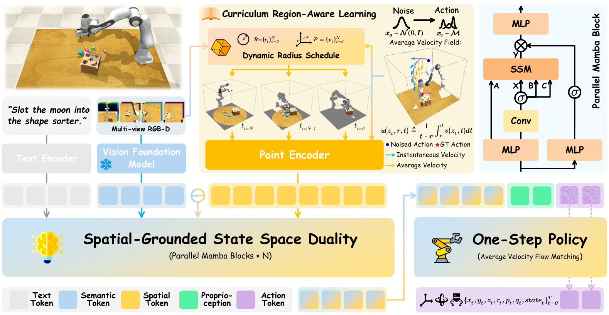
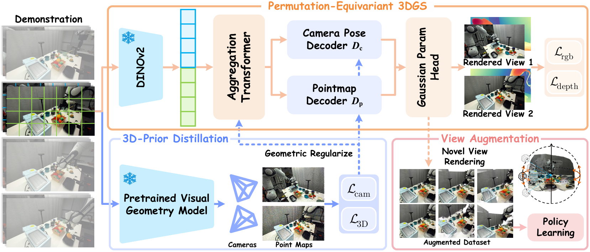
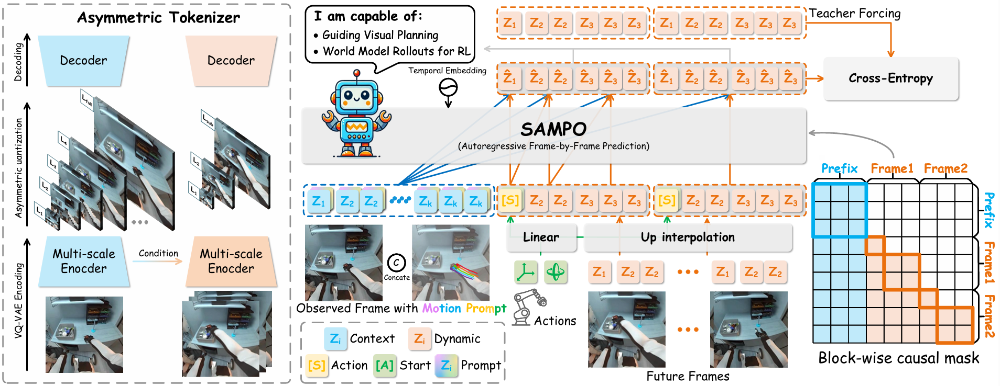
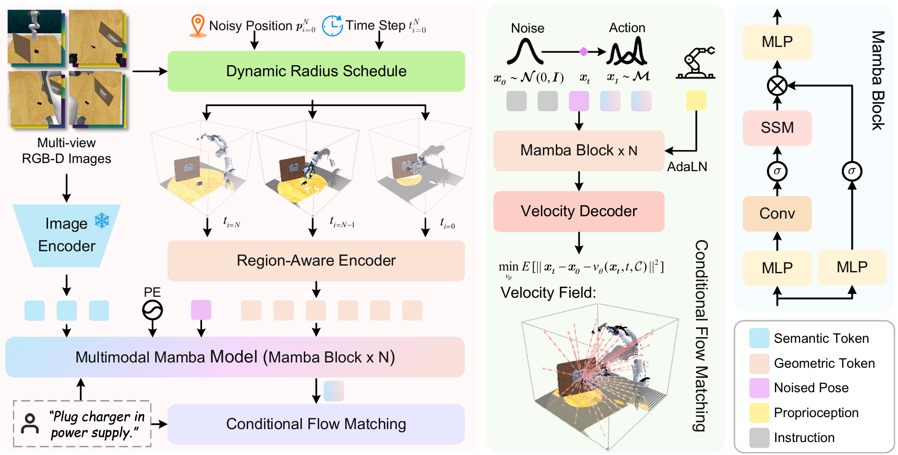
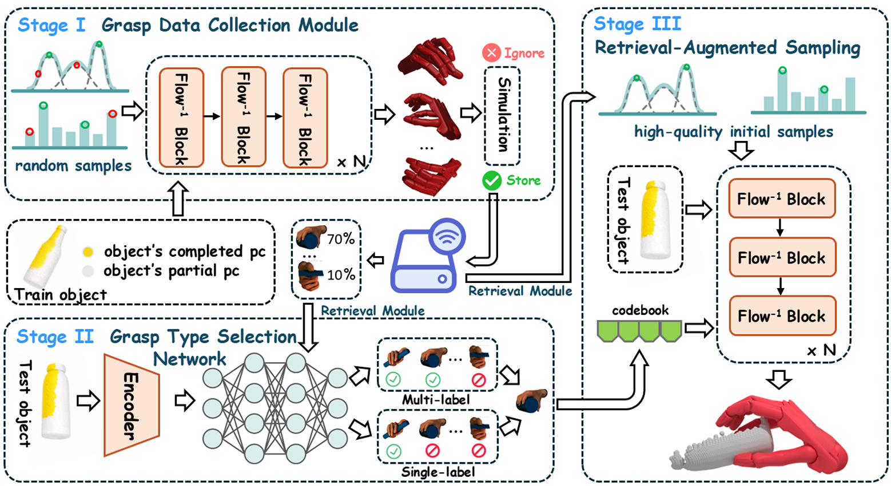
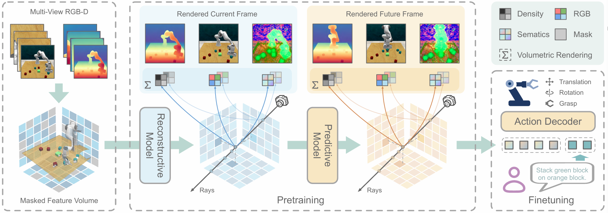
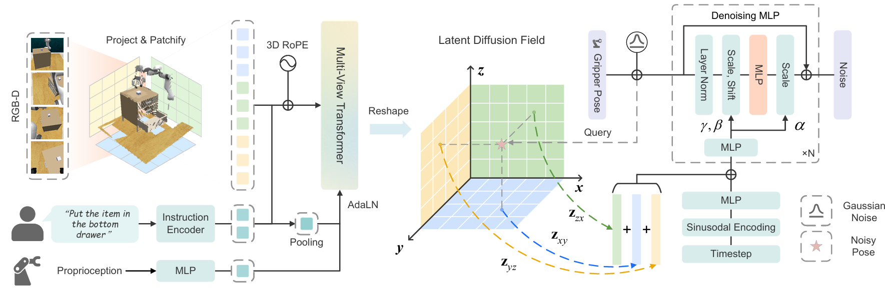








I am currently a fourth-year Ph.D. candidate in the Institute of Artificial Intelligence and Robotics at Xi'an Jiaotong University ([IAIR](https://iair.xjtu.edu.cn/index.htm), [XJTU](https://www.xjtu.edu.cn/)), where I am pursuing my doctoral studies under the guidance of Prof.[Le Wang](https://gr.xjtu.edu.cn/web/lewang). I also collaborate closely with Prof.[Sanping Zhou](https://gr.xjtu.edu.cn/web/spzhou), Prof.[Gang Hua](https://www.ganghua.org/) and Prof.[Wei Tang](https://www.cs.uic.edu/~tangw/).
Previously, I earned my B.Eng. in Control Science and Engineering from Jilin University.

My research interest focus on Robotic Manipulation, with particular emphasis on vision language action model and world model. I welcome any inquiries regarding potential collaboration in these areas.

# 🔥 News
- 2026.09: 📄 Our new preprints [CogWAM](https://arxiv.org/abs/2609.37721) and [ReWAM](https://arxiv.org/abs/2609.38163) are now available on arXiv.
- 2026.08: 🎉 SAMPO++ (Action-Controlled Scale-Wise Flow Matching) was accepted by TPAMI.
- 2026.07: 🎉 Flow2Act was accepted by TPAMI.
- 2026.06: 🎉 Two papers were accepted to ECCV 2026.
- 2025.09: 🎉 Two papers were accepted to NeurIPS 2025.
- 2025.06: 🎉 PDFactor was selected for an **oral** presentation.  
- 2025.03: 🎉 Two papers were accepted to CVPR 2025.
- 2023.06: 🎓 Graduated from Jilin University.

# 📝 Selected Publications 

  

    
  

  

    <h3>CogWAM: Aligning Semantic Cognition with World Action Modeling via Event-Driven Interfaces</h3>
    

      <strong>Sen Wang</strong>, Liu Liu, Xinjiang Wang, Zequn Chen, Haoyi Jiang, Taojun Ding, Tingyang Xiao, Zhizhong Su, Jie Wang, Sanping Zhou
    

    
arXiv preprint, 2026

    

      <a href="https://horizonrobotics.github.io/CogWAM/" class="btn-accent"><i class="fas fa-project-diagram"></i> Project</a>
      <a href="https://arxiv.org/abs/2609.37721" class="btn-accent"><i class="fas fa-file-alt"></i> Paper</a>
      <a href="https://github.com/HorizonRobotics/CogWAM" class="btn-accent"><i class="fab fa-github"></i> Code</a>
      <a href="#work-demos" class="btn-accent"><i class="fas fa-play-circle"></i> Video</a>
    

  

  

    
  

  

    <h3>Action-Controlled Scale-Wise Flow Matching for Embodied World Models</h3>
    

      <strong>Sen Wang*</strong>, Sanping Zhou, Huaiyi Dong, Kun Xia, Gang Hua, Le Wang
    

    
IEEE Transactions on Pattern Analysis and Machine Intelligence (TPAMI)

    

      <a href="https://sanmumumu.github.io/SAMPO_plus_plus/" class="btn-accent"><i class="fas fa-project-diagram"></i> Project</a>
      <a href="https://sanmumumu.github.io/SAMPO_plus_plus/assets/docs/SAMPO++_preview.pdf" class="btn-accent"><i class="fas fa-file-alt"></i> Paper</a>
      <a href="https://github.com/SanMumumu/SAMPO_plus_plus" class="btn-accent"><i class="fab fa-github"></i> Code</a>
    

  

  

    
  

  

    <h3>Integrating Agglomerative Perception with One-step Action Generation for Robotic Manipulation</h3>
    

      <strong>Sen Wang*</strong>, Le Wang, Hongcheng Huo, Sanping Zhou, Kun Xia, Gang Hua
    

    
IEEE Transactions on Pattern Analysis and Machine Intelligence (TPAMI)

    

      <a href="https://sanmumumu.github.io/Flow2Act/" class="btn-accent"><i class="fas fa-project-diagram"></i> Project</a>
      <a href="https://sanmumumu.github.io/Flow2Act/static/pdfs/paper.pdf" class="btn-accent"><i class="fas fa-file-alt"></i> Paper</a>
    

  

  

    
  

  

    <h3>Efficient Camera Pose Augmentation for View Generalization in Robotic Policy Learning</h3>
    

      <strong>Sen Wang*</strong>, Huaiyi Dong, Jingyi Tian, Jiayi Li, Zhuo Yang, Tongtong Cao, Anlin Chen, Shuang Wu, Le Wang, Sanping Zhou
    

    
The 19th European Conference on Computer Vision

    

      <a href="https://arxiv.org/abs/2603.29192" class="btn-accent"><i class="fas fa-file-alt"></i> Paper</a>
      <a href="https://github.com/SanMumumu/GenSplat" class="btn-accent"><i class="fab fa-github"></i> Code</a>
    

  

  

    
  

  

    <h3>SAMPO: Scale-wise Autoregression with Motion Prompt for Generative World Models</h3>
    

      <strong>Sen Wang*</strong>, Jingyi Tian, Le Wang†, Zhimin Liao, Jiayi Li, Huaiyi Dong, Kun Xia, Sanping Zhou, Wei Tang, Gang Hua
    

    
The 39th Annual Conference on Neural Information Processing Systems

    

      <a href="https://sanmumumu.github.io/SAMPO/" class="btn-accent"><i class="fas fa-project-diagram"></i> Project</a>
      <a href="https://arxiv.org/abs/2509.15536" class="btn-accent"><i class="fas fa-file-alt"></i> Paper</a>
      <a href="https://github.com/SanMumumu/SAMPO" class="btn-accent"><i class="fab fa-github"></i> Code</a>
    

  

  

    
  

  

    <h3>FlowRAM: Grounding Flow Matching Policy with Region-Aware Mamba Framework for Robotic Manipulation</h3>
    

      <strong>Sen Wang*</strong>, Le Wang†, Sanping Zhou, Jingyi Tian, Jiayi Li, Haowen Sun, Wei Tang
    

    
The 42nd IEEE/CVF Conference on Computer Vision and Pattern Recognition

    

      <a href="https://sanmumumu.github.io/FlowRAM/" class="btn-accent"><i class="fas fa-project-diagram"></i> Project</a>
      <a href="https://openaccess.thecvf.com/content/CVPR2025/papers/Wang_FlowRAM_Grounding_Flow_Matching_Policy_with_Region-Aware_Mamba_Framework_for_CVPR_2025_paper.pdf" class="btn-accent"><i class="fas fa-file-alt"></i> Paper</a>
      <a href="https://github.com/SanMumumu/FlowRAM" class="btn-accent"><i class="fab fa-github"></i> Code</a>
    

  

# 📝 Collaboration Papers

  

    
    <svg viewBox="0 0 600 320" role="img"
         aria-label="ReWAM schematic: DINO features, feature calibration, temporal representation bottleneck, world and action models"
         style="display:none; width:100%; height:auto; background:#f7f9fc" xmlns="http://www.w3.org/2000/svg">
      <rect width="600" height="320" rx="12" fill="#f4f7fb"/>
      <text x="30" y="60" font-size="46" font-weight="700" fill="#19344c" font-family="Arial,sans-serif">ReWAM</text>
      <text x="30" y="93" font-size="19" fill="#536879" font-family="Arial,sans-serif">Representation-Centric World-Action Model</text>
      <rect x="30" y="140" width="148" height="75" rx="10" fill="#dfeafe" stroke="#9dbbe6"/>
      <text x="104" y="184" text-anchor="middle" font-size="23" fill="#19344c" font-family="Arial,sans-serif">DINO</text>
      <path d="M180 177 H211" stroke="#70899d" stroke-width="4" fill="none"/>
      <path d="M207 170 L218 177 L207 184" stroke="#70899d" stroke-width="4" fill="none"/>
      <rect x="222" y="140" width="148" height="75" rx="10" fill="#dfeafe" stroke="#9dbbe6"/>
      <text x="296" y="172" text-anchor="middle" font-size="19" fill="#19344c" font-family="Arial,sans-serif">Feature</text>
      <text x="296" y="196" text-anchor="middle" font-size="19" fill="#19344c" font-family="Arial,sans-serif">Calibration</text>
      <path d="M372 177 H403" stroke="#70899d" stroke-width="4" fill="none"/>
      <path d="M399 170 L410 177 L399 184" stroke="#70899d" stroke-width="4" fill="none"/>
      <rect x="414" y="140" width="156" height="75" rx="10" fill="#d2eee5" stroke="#86bfa9"/>
      <text x="492" y="174" text-anchor="middle" font-size="23" fill="#196858" font-family="Arial,sans-serif">Temporal</text>
      <text x="492" y="199" text-anchor="middle" font-size="23" fill="#196858" font-family="Arial,sans-serif">Bottleneck</text>
      <text x="300" y="270" text-anchor="middle" font-size="20" fill="#54697a" font-family="Arial,sans-serif">Action-Grounded Representation Shaping</text>
    </svg>
  

  

    <h3>ReWAM: Rethinking Representations for World-Action Modeling</h3>
    

      Haoyi Jiang, Liu Liu, Xinjiang Wang, Zhihao Sun, Zequn Chen, <strong>Sen Wang</strong>, Xinjie Wang, Xia Chen, Jingfeng Yao, Weiheng Zhao, Shanglin Yuan, Zhizhong Su, Wei Sui, Wenyu Liu, Xinggang Wang
    

    
arXiv preprint, 2026

    

      <a href="https://arxiv.org/abs/2609.38163" class="btn-accent"><i class="fas fa-file-alt"></i> Paper</a>
      <a href="https://github.com/hustvl/ReWAM" class="btn-accent"><i class="fab fa-github"></i> Repository</a>
    

  

  

    
  

  

    <h3>RAGrasp: A Retrieval-Augmented Framework with Diversity-Aware Modeling for Dexterous Grasp Generation</h3>
    

      Zhuo Yang, Sanping Zhou†, <strong>Sen Wang*</strong>, Jingyi Tian, Jiayi Li, Gang Hua, Le Wang
    

    
The 19th European Conference on Computer Vision

    

      <a href="https://link.springer.com/chapter/10.1007/978-3-032-37356-4_3" class="btn-accent"><i class="fas fa-file-alt"></i> Paper</a>
      <a href="https://media.eventhosts.cc/Conferences/ECCV2026/pdfs/1642.pdf" class="btn-accent"><i class="fas fa-file-pdf"></i> PDF</a>
    

  

  

    
  

  

    <h3>DynaRend: Learning 3D Dynamics via Masked Future Rendering for Robotic Manipulation</h3>
    

      Jingyi Tian, Le Wang†, Sanping Zhou, <strong>Sen Wang*</strong>, Jiayi Li, Hua Gang
    

    
The 39th Annual Conference on Neural Information Processing Systems

    

      <a href="https://arxiv.org/pdf/2510.24261" class="btn-accent"><i class="fas fa-file-alt"></i> Paper</a>
    

  

  

    
  

  

    <h3>PDFactor: Learning Tri-Perspective View Policy Diffusion Field for Multi-Task Robotic Manipulation</h3>
    

      Jingyi Tian, Le Wang†, Sanping Zhou, <strong>Sen Wang*</strong>, Jiayi Li, Haowen Sun, Wei Tang
    

    
The 42nd IEEE/CVF Conference on Computer Vision and Pattern Recognition

    

      <a href="https://openaccess.thecvf.com/content/CVPR2025/papers/Tian_PDFactor_Learning_Tri-Perspective_View_Policy_Diffusion_Field_for_Multi-Task_Robotic_CVPR_2025_paper.pdf" class="btn-accent"><i class="fas fa-file-alt"></i> Paper</a>
    

  

# 🏅 Honors & Awards
- *2025.11*, Second Prize in the Artificial Intelligence+ Special Competition, 19th Challenge Cup National College Students' Extracurricular Academic Science and Technology Works Competition [**(Cert.)**](../images/挑战杯国赛二等奖.pdf)
- *2025.10*, *2024.10*, Academic Scholarship, XJTU
- *2025.06*, First Prize in the 15th Challenge Cup Shaanxi Province College Students' Extracurricular Academic Science and Technology Works Competition [**(Cert.)**](../images/挑战杯省赛一等奖.jpg)
- *2024.06*, Runner-up in the 5th Embodied AI Workshop, CVPR [**(Cert.)**](../images/2024_Award_cvprws.png)
- *2023.10*, Freshman Scholarship, XJTU
- *2023.06*, Outstanding Graduates Student, JLU
- *2022.12, 2021.12*, National Encouragement Scholarship, MOE of PRC

# 💬 Invited Talks & Community Services
- **Reviewer:** CVPR 2026, ECCV 2026
- *2025.06.15*, Give an oral presentation on *Embodied Computer Vision* in Nashville at CVPR 25 conference. \|[**(Slide)**](https://cvpr.thecvf.com/media/cvpr-2025/Slides/35335.pdf) \| [**(Video)**](https://youtu.be/Y3P9wKyzLcM)

# 💻 Internships

  <a class="internship-card" href="https://www.horizon.auto/">
    

      
    

    

      
2026.04 - present

      <h3>Horizon Robotics Lab</h3>
      
China

    

  </a>
  <a class="internship-card" href="https://noahlab.com.hk/#/home">
    

      
    

    

      
2025.03 - 2026.03

      <h3>Noah's Ark Lab</h3>
      
China

    

  </a>

# 🎞️ Work Demos

  

    <!-- Slide 1: CogWAM method overview, hosted on the official project site -->
    

      <video controls playsinline preload="metadata"
             poster="https://horizonrobotics.github.io/CogWAM/assets/figures/fig1.png"
             aria-label="CogWAM method overview video">
        <source src="https://horizonrobotics.github.io/CogWAM/assets/videos/method_overview.mp4" type="video/mp4">
        Your browser does not support HTML5 video.
      </video>
      

        <strong>CogWAM</strong> — Event-Driven Semantic Cognition
        · <a href="https://horizonrobotics.github.io/CogWAM/">Project</a>
        · <a href="https://arxiv.org/abs/2609.37721">Paper</a>
      

    

    <!-- Slide 2: existing local mp4 -->
    

      <video controls playsinline preload="metadata">
        <source src="{{ '../videos/model_description.mp4' | relative_url }}" type="video/mp4">
      </video>
    

    <!-- Slide 3: GenSplat ECCV 2026 presentation -->
    

      <iframe
        class="fitvidsignore"
        width="640"
        height="360"
        src="https://www.youtube.com/embed/UDx4k6q2bGA?feature=oembed"
        title="GenSplat: Efficient Camera Pose Augmentation for View Generalization in Robotic Policy Learning"
        allow="accelerometer; autoplay; clipboard-write; encrypted-media; gyroscope; picture-in-picture; web-share"
        referrerpolicy="strict-origin-when-cross-origin"
        allowfullscreen>
      </iframe>
    

  

  <a class="prev" onclick="plusSlides(-1)">&#10094;</a>
  <a class="next" onclick="plusSlides(1)">&#10095;</a>

  
  
  

# 📖 Educations
- *2023.09 - present*, Ph.D. student, College of Artificial Intelligence, [Xi'an Jiaotong University](https://www.xjtu.edu.cn/), 
- *2019.09 - 2023.06*, B.S., Control Science and Engineering, [Jilin University](https://www.jlu.edu.cn/)
